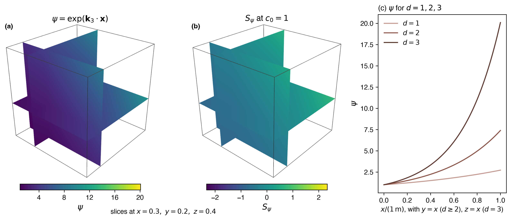
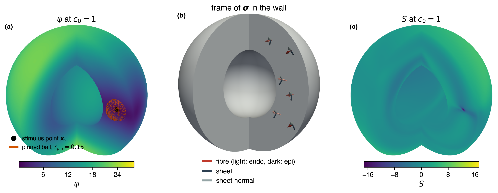
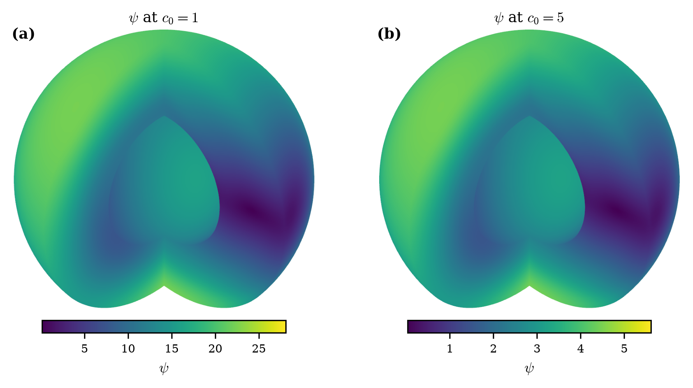

# The problem {#sec-problem}

This document describes how each manufactured solution of the
eikonal--diffusion equation used by cardiacFoam is built. In the method of
manufactured solutions [@roache2002code] an exact field is chosen first and the
source that makes it satisfy the equation is derived from it. The document
gives the exact activation times, the sources that make them exact, the reference values of the
eikonal-driven ECG and the checks that each construction passes before
anything is written. It states the problems only; it contains no solver
output. Every displayed field, source and coefficient below is printed by the
sympy generator that also writes the NumPy reference module and, for
cardiacFoam, the C++ reference header, so the document, the references and the
solver cannot disagree. A reader with this document and the generator folder
can rebuild each problem in another code.

## Domain and governing equations

The activation time $\psi(\mathbf x)$ solves the anisotropic
eikonal--diffusion equation [@collifranzone1990eikonal; @jacquemet2012eikonal]
in the myocardium $\Omega\subset\mathbb R^d$,

$$
-\nabla\cdot(\mathbf M\nabla\psi)
+c_0\sqrt{\nabla\psi\cdot\mathbf M\nabla\psi}
=1+S,
\qquad
\mathbf M=\frac{\boldsymbol{\sigma}}{\chi C_m},
$$

where $S$ is the manufactured source ($S=0$ in ordinary runs) and $c_0$, in
s$^{-1/2}$, is a scaling coefficient rather than a conduction velocity.
Ordinary runs seal the walls, $\mathbf n\cdot\mathbf M\nabla\psi=0$, and
prescribe $\psi=0$ at the stimulus sites. Each manufactured problem states its
own boundary and interior constraints: the Cartesian cube prescribes the exact
$\psi$ on the boundary, and the shell seals both walls and pins a small ball of
cells about the stimulus point. The source is the residual of the operator on
the exact field,
$S=-\nabla\cdot(\mathbf M\nabla\psi)+c_0\sqrt{\nabla\psi\cdot\mathbf M\nabla\psi}-1$.

The normalised cases use the solver's dimensional convention: $\psi$ in s,
$\mathbf M$ in m$^2$ s$^{-1}$ and $c_0$ in s$^{-1/2}$, with the fields written
on the normalised coordinates $x/(1\,\mathrm m)$, so the arguments of the
exponential and square-root functions are dimensionless.

The eikonal-driven ECG observes $\psi$ through a transmembrane template
$U$ [@pezzuto2017rapid]: $V_m(\mathbf x,t)=U(t-\psi(\mathbf x))$, so
$\nabla V_m=-U'(t-\psi)\nabla\psi$, substituted in the pseudo-ECG
functional [@gima2002ionic] with the normalisation $c_{\mathrm{ECG}}=1$.

## Nomenclature



## Reading and regenerating {#sec-regenerate}

The generators live in `tutorials/manufacturedSolutions/generators/` of the
cardiacFoam repository. Each case has one sympy generator `<case>_mms.py` that
writes `reference/<case>.py`, a NumPy-only module with the exact fields,
sources and reference quadratures, and `latex/<case>_*.tex`, the fragments
printed in this document. Set up the environment once and run a generator
from that folder:

```bash
python3 -m venv .venv && .venv/bin/pip install -r requirements.txt
.venv/bin/python cartesian_eikonal_mms.py --emit
.venv/bin/python cartesian_eikonal_mms.py --self-check
```

`--emit` runs the self-checks first and writes nothing if one fails;
`--self-check` runs them alone. The generators that own a cardiacFoam header
also take `--check PATH` and `--write PATH`, needed only by cardiacFoam
developers. The document is built with

```bash
quarto render docs/eikonal/eikonal_mms.qmd --to pdf
```

and its figures with `python docs/eikonal/figures.py`.

# Cartesian eikonal field {#sec-cartesian}

## Description and limitations

An exponential activation time on the unit cube $[0,1]^d$, $d=1,2,3$, with a
constant conductivity tensor, full or diagonal. The case exercises the
interior discretisation of the eikonal--diffusion operator: the metric term,
the anisotropic diffusion term with a full tensor, the cell-gradient
reconstruction and the outer nonlinear iteration.

The exact $\psi$ is prescribed on every face and on the cells whose centre has
the smallest $x$, $y$ or $z$, so the case exercises neither a sealed wall,
nor the zero-gradient outer boundary of ordinary runs, nor the placement of
internal stimulus sites. The tensor is constant, so its derivatives do not
enter the source.

## Problem instance

Unit cube $[0,1]^d$ with



and one of the two tensors of the tutorial,





In cardiacFoam this is the tutorial `eikonalECG` (`-conductivity rotated`, the
default, or `axis`; `-dim 1|2|3`) with the verifier
`manufacturedEikonalVerifier`.

## Construction

The field is the exponential of a linear form,



chosen because it reproduces itself under differentiation:
$\nabla\psi=\mathbf k_d\psi$. With $\mathbf M$ constant,
$\nabla\psi\cdot\mathbf M\nabla\psi=K_M\psi^2$ and
$\nabla\cdot(\mathbf M\nabla\psi)=K_M\psi$, so with $\psi>0$ the left-hand side
of the equation equals $\psi(c_0\sqrt{K_M}-K_M)$ and the source follows in
closed form. The construction requires $K_M>0$; a tensor that is not positive
along $\mathbf k_d$ is rejected (the C++ verifier rejects
$K_M\le10^{-300}$).

## Exact solution













The full expressions are `fields(d, sigma, chi, cm, c0)` of
`cartesian_eikonal_mms.py`, and `tau_d<d>`, `grad_tau_d<d>`, `source_d<d>` and
the checked wrapper `source(d, point, sigma, c0, chi, cm)` of
`reference/cartesian_eikonal.py`.

## Self-checks

`--self-check` asserts that the residual of the eikonal equation with the
source vanishes to $10^{-12}$ at a sample point for $d=1,2,3$, for both
tutorial tensors and for $c_0\in\{1,5,66\}$; and that a tensor with $K_M=0$ is
rejected.

## Figures

{#fig-cartesian width=100%}

::: {#fig-cartesian-mesh layout-ncol=2}

{#fig-cartesian-mesh-hex}

{#fig-cartesian-mesh-tet}

Meshes of the unit cube from the tutorial `eikonalECG` (`-dim 3`), made by the meshing steps of its `Allrun` at a coarse resolution chosen for legibility (the tutorial default is $N=20$): (a) `blockMesh` with $N=8$ cells per unit length; (b) `gmsh` tetrahedra of element size $1/5$, seed 1, converted by `gmshToFoam`. The octant facing the viewer is removed cell by cell.
:::

## Regeneration

```bash
python cartesian_eikonal_mms.py --emit
python cartesian_eikonal_mms.py --self-check
H=../../../src/verificationModels/eikonalVerification
python cartesian_eikonal_mms.py --check $H/manufacturedEikonalReference.H
```

`--emit` writes `reference/cartesian_eikonal.py` and `latex/eikonal_*.tex`.
The header regions are $\mathbf k_d$, $\psi$ and $\nabla\psi$, $K_M$ and
$S_\psi$; $\mathbf M=\boldsymbol\sigma/(\chi C_m)$ and the positivity guard on
$K_M$ are hand-written.

# Eikonal-driven ECG {#sec-eikonal-ecg}

## Description and limitations

The eikonal-driven ECG of the Cartesian field of @sec-cartesian: the
pseudo-ECG functional of the template voltage $V_m=U(t-\psi)$ at electrodes
outside the cube. The case exercises the chain from the computed activation
time through its reconstructed gradient and the template to the functional;
its reference uses the exact gradient $\nabla\psi=\mathbf k_d\psi$. The
reference is a quadrature of the exact integrand, not a closed form. The
generator covers the cube; the shell ECG reference of cardiacFoam
(`domain shell`) is the same integrand over the shell of @sec-shell, computed
by the verifier from the shell header and not part of the emitted modules.
The sine template repeats many times across the activation range, so its
integrand changes sign many times over the cube and the integral cancels to a
small fraction of the sum of the magnitudes of its terms.

## Problem instance

Two templates: a single smooth event and a sine. The single event is







so that $H$ rises from 10% to 90% within the rise time $T_r$, with



The duration $D$ exceeds the activation range $e^3-1$ of $d=3$, so
$U'(t-\psi)$ keeps one sign across the cube. The sine template is



In cardiacFoam:

- the ECG of the tutorial `eikonalECG`;
- verifier `manufacturedEikonalECGVerifier`;
- `template singleEvent` (the default) or `template sine`.

## Construction

With $\mathbf r=\mathbf x-\mathbf r_e$, and in $d<3$ only the first $d$
coordinates of $\mathbf r$, the functional is the integral over $[0,1]^d$ of



with $U'$ evaluated at $t-\psi(\mathbf x)$. With
$a=\tanh(s/w)$ and $b=\tanh((s-D)/w)$, the template derivatives are







## Exact solution

The reference $\Phi_e(\mathbf r_e,t)$ is a tensor-product Gauss--Legendre
quadrature with $q_{\mathrm{ref}}$ points per axis on $[0,1]^d$. The functional
has no separate time factor: the time enters through $U'(t-\psi)$ at every
quadrature point. The NumPy module holds
`integrand_d<d>_<template>(x, y, z, t, ex, ey, ez, sxx, sxy, sxz, syy, syz, szz, duration, rise)`,
`template_derivative_single_event`, `template_derivative_sine` and
`spatial_reference(d, template, sigma, electrode, t, order, duration, rise)`.

*Note for implementers.* The tutorial uses $q_{\mathrm{ref}}=48$. The
integrand is set to 0 where $\lVert\mathbf r\rVert^2\le10^{-300}$
($|x-r_{e,x}|\le10^{-300}$ in $d=1$), so an electrode that coincides with a
quadrature point contributes 0, not a non-finite value. Because the quadrature
sum cancels (the functional can be $10^{-6}$ of the sum of the magnitudes of
its terms) and $\tanh$ and $\cos$ are evaluated in a different order by
different codes, two correct implementations agree only to a bound that scales
with those magnitudes, not to a fixed relative tolerance. cardiacFoam compares
its C++ reference with the NumPy reference within
$10^{-12}|\Phi_e|+2\times10^{-13}\sum_q|W_q\,U'\,\kappa|+3\times10^{-15}\sum_q|W_q\,\kappa|$,
with $W_q$ the quadrature weights and $\kappa=\mathbf r\cdot\boldsymbol\sigma\nabla\psi/\lVert\mathbf r\rVert^3$
the kernel at the quadrature points. For the shell, cardiacFoam integrates the
same kernel with $q$ Gauss--Legendre nodes in the radius $|\mathbf x|$ (Jacobian
$|\mathbf x|^2$) and in $\mu=\cos\vartheta$, with $\vartheta$ the polar angle, and $2q$
trapezoid nodes in the azimuth.

## Self-checks

`--self-check` asserts that the integrand equals the Cartesian component form
of the C++ reference for $d=1,2,3$ and both templates, to $10^{-12}$; that it
vanishes at an electrode on the evaluation point; that the reference at a
sample electrode agrees between orders 48 and 96 to $10^{-10}\max(1,|\Phi_e|)$,
an absolute bound for $|\Phi_e|\le1$ and a relative one above; and
that the printed single-event building blocks ($H$, $U$, $w$, $a$, $b$) give
the same $U'$ as the template derivative of the generator and as the
derivative of $U$.

## Figures

{#fig-eikonal-ecg width=100%}

## Regeneration

```bash
python eikonal_ecg_mms.py --emit
python eikonal_ecg_mms.py --self-check
H=../../../src/verificationModels/eikonalVerification
python eikonal_ecg_mms.py --check $H/manufacturedEikonalReference.H
```

`--emit` writes `reference/eikonal_ecg.py` and `latex/eikonal_ecg_*.tex`. The
header region is the kernel of the C++ integrand for $d=1,2,3$; the guards,
$-\boldsymbol\sigma\nabla\psi\,U'$ and the template derivatives are
hand-written.

# Sealed spherical shell {#sec-shell}

## Description and limitations

The heart-like shell $r_1<|\mathbf x|<r_2$ with both spheres sealed, the
rotating anisotropic conductivity of the monodomain shell, and an activation
time spreading from a mid-wall stimulus point. The exact $\psi$ has non-zero
normal and tangential gradients on both walls while
$\mathbf n\cdot\mathbf M\nabla\psi=0$ holds there exactly, and its wavefronts
collide on the walls behind the cavity. The case poses the full sealed-wall
problem: curved walls, a rotating anisotropic tensor oblique to both walls,
and a spatially varying metric whose derivatives enter the source. At the
critical points of $\psi$ on the walls the metric
$\sqrt{\nabla\psi\cdot\mathbf M\nabla\psi}$ is not differentiable, so the
source is finite there but not smooth; this is a feature of the solution.

The sealed problem fixes $\psi$ only up to a constant, so the cells near the
stimulus point are pinned to the exact $\psi$: the case does not exercise a
stimulus region or the constraint $\psi=0$ of ordinary runs.

The construction is parametric in $c_0$. The stated problem instance is
$c_0=1$; a higher $c_0$ lies outside the regime in which the solver paper
verifies the shell, and the document makes no statement about it.

## Problem instance



with the stimulus point



The verifier
pins the cells whose centre lies within $r_{\mathrm{pin}}$ of $\mathbf x_s$ to
the exact $\psi$ (the nearest cell when the mesh has no centre in that ball)
and imposes no value on a wall. In cardiacFoam this is
`eikonalECG/sphericalShell` with the verifier
`manufacturedShellEikonalVerifier`; its `Allrun` takes `-c0 <value>`
(default 1). The verifier reads $c_0$ from the case, so the source follows the
value given.

## Construction

*Geometry and conductivity.* $\lambda$, $\omega$, the fibre frame, the tensor
$\boldsymbol\sigma$, the wall normals $\mathbf n_j$ and $d_j$ are those of the
monodomain shell:























*Unsealed field.* The smoothed anisotropic distance from $\mathbf x_s$,
measured in the metric frozen at the stimulus point, divided by $c_0$, with
the smoothing length $\delta$ keeping it differentiable at $\mathbf x_s$:







*Sealing.* The correction of the monodomain shell, written for the operator
tensor $\mathbf M$:







so that $\mathbf n_j\cdot\mathbf M\nabla\psi=0$ on both spheres.

*Dependence on $c_0$.* $\hat h$ and $m$ both carry the factor $1/c_0$, so
$\psi$ scales as $1/c_0$: its critical points and their types do not depend on
$c_0$, while the source does. The checks can be run at any $c_0$
(`--self-check --c0 VALUE`).

## Exact solution

The source is the residual of the operator on the exact field, including the
derivatives of the spatially varying $\mathbf M$:



The expanded $\psi$, $\nabla\psi$ and source are not printed: they are
`expressions()` of `shell_eikonal_mms.py` and `psi`, `gradPsi`, `source` and
`sigma` of `reference/shell_eikonal.py`, functions of $(x,y,z)$ and the
parameters, with `field(name, x, y, z, **overrides)` to evaluate them with the
default parameters; `c0` is one of those parameters.

## Self-checks

`--self-check` (at $c_0=1$, or at `--c0 VALUE`) asserts:

- the stored $\mathbf M_s^{-1}$ inverts $\mathbf M(\mathbf x_s)$ to
  $10^{-12}$, and $|\mathbf x_s|=0.75$;
- sealing: $\max|\mathbf n\cdot\mathbf M\nabla\psi|<10^{-25}$ at 200 points
  of each sphere in 30-digit arithmetic;
- the gradient against central differences of $\psi$ to $10^{-5}$, and the
  source against central differences of the flux to $10^{-6}$;
- $\mathbf n_j\cdot\boldsymbol\sigma\mathbf n_j>0$ over the shell widened by
  0.05, and the source finite at $2\times10^{5}$ points of the shell;
- critical points: on each sphere the Morse count (minima $-$ saddles $+$
  maxima) of $\psi$ is 2, so the wall critical points found are complete;
  every interior critical point lies in the pinned ball; every critical point
  outside the ball is non-degenerate (smallest to largest absolute Hessian
  eigenvalue above $10^{-3}$); the local minima outside the ball have
  $\psi>0$ and the pinned minimum exceeds $-10^{-2}$; the source is finite
  next to every critical point.

`--report [--c0 VALUE]` prints the table of critical points.

## Figures

{#fig-shell width=100%}

{#fig-shell-c0 width=80%}

::: {#fig-shell-mesh layout-ncol=2}

{#fig-shell-mesh-hex}

{#fig-shell-mesh-tet}

Meshes of the shell from the tutorial `eikonalECG/sphericalShell`, made by the meshing steps of its `Allrun` at a coarse resolution chosen for legibility (the tutorial default is $N=12$): (a) the `blockMesh` cubed sphere with $N=8$; (b) `gmsh` tetrahedra of element size $1/5$, seed 1, converted by `gmshToFoam`. The octant facing the viewer is removed cell by cell, exposing the cavity.
:::

## Regeneration

```bash
python shell_eikonal_mms.py --emit
python shell_eikonal_mms.py --self-check [--c0 VALUE]
python shell_eikonal_mms.py --report [--c0 VALUE]
H=../../../src/verificationModels/eikonalVerification
python shell_eikonal_mms.py --check $H/manufacturedShellEikonalReference.H
```

`--emit` writes `reference/shell_eikonal.py` and `latex/shell_eikonal_*.tex`;
the geometry fragments `latex/shell_*.tex` are written by
`shell_monodomain_mms.py`. The header and the emitted module carry $c_0$ as a
runtime parameter and are written at $c_0=1$.

# References {.unnumbered}

::: {#refs}
:::
