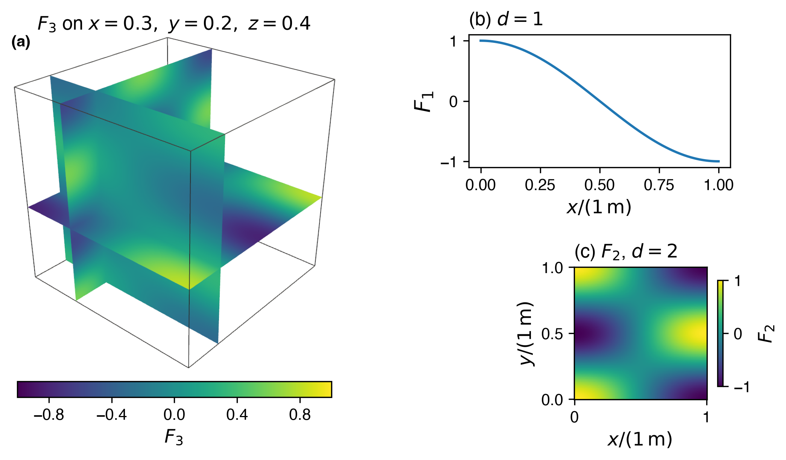
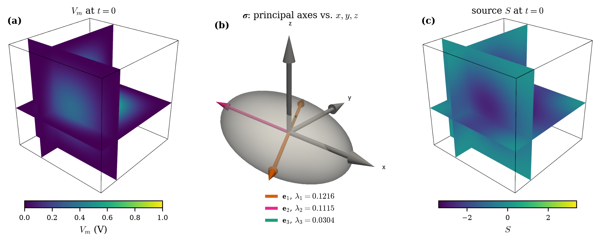
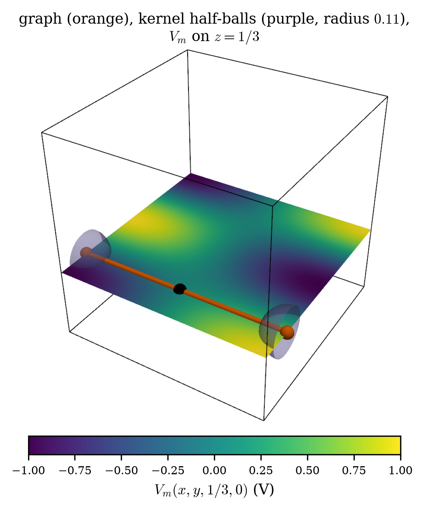

# The problem {#sec-problem}

This document describes how each manufactured solution of the monodomain
equation used by cardiacFoam is built. In the method of manufactured solutions
[@roache2002code] an exact field is chosen first and the source that makes it
satisfy the equation is derived from it. The document gives the exact fields,
the sources that make them exact, the reference values of the derived functionals and the checks
that each construction passes before anything is written. It states the
problems only; it contains no solver output. Every displayed field, source and
coefficient below is printed by the sympy generator that also writes the
NumPy reference module and, for cardiacFoam, the C++ reference header, so the
document, the references and the solver cannot disagree. A reader with this
document and the generator folder can rebuild each problem in another code.

## Domain and governing equations

In the myocardium $\Omega\subset\mathbb R^d$, $d\in\{1,2,3\}$, with sealed
boundary $\partial\Omega$ and outward unit normal $\mathbf n$, the monodomain
equation is

$$
\left\{
\begin{aligned}
\chi C_m \frac{\partial V_m}{\partial t}
&=\nabla\cdot\left(\boldsymbol{\sigma}\nabla V_m\right)
-\chi C_m I_{\mathrm{ion}}+I_{\mathrm{app}}
&&\text{in }\Omega,\\
\mathbf n\cdot\left(\boldsymbol{\sigma}\nabla V_m\right)&=0
&&\text{on }\partial\Omega,
\end{aligned}
\right.
$$

with the ionic closure

$$
I_{\mathrm{ion}}=I(V_m,\mathbf w),
\qquad
\frac{\mathrm d\mathbf w}{\mathrm dt}=\mathbf F(V_m,\mathbf w),
$$

and initial data $V_m(\mathbf x,0)$, $\mathbf w(\mathbf x,0)$. Every
manufactured problem below prescribes the exact fields at $t=0$ as initial
data, and the zero conormal flux on every wall is satisfied by the exact field
itself. The applied current $I_{\mathrm{app}}$ carries the manufactured source
$S$ where a case needs one.

The continuum equations use SI units: potentials in V, time in s, length in m,
$\chi$ in m$^{-1}$, $C_m$ in F m$^{-2}$ and conductivity in S m$^{-1}$;
$I_{\mathrm{ion}}$ is capacitance-normalised (V s$^{-1}$) and
$I_{\mathrm{app}}$ is in A m$^{-3}$. The manufactured fields are written in
case units on the normalised coordinates $x/(1\,\mathrm m)$ and
$t/(1\,\mathrm s)$, so the arguments of the trigonometric, exponential and
square-root functions are dimensionless.

## Manufactured ionic closure {#sec-ionic}

Every case uses the manufactured ionic model of @pathmanathan2013verification,
with state $(V_m,u_1,u_2,u_3)$. The solver supplies $V_m$; the model advances
the auxiliary states with $V_m$ held fixed, at the rates





and $\dot u_3=0$. The model returns the current before capacitance
normalisation,



and the myocardium solver divides it by $C_m$,



because the equation carries $-\chi C_m I_{\mathrm{ion}}$. The constants, with
$\beta_d$ the reaction coefficient of dimension $d$, are



Each case sets $u_1$ and $u_2$ from its own spatial factor so that the two
rates hold exactly on the exact fields (@sec-fda, @sec-shell).

## Nomenclature





## Reading and regenerating {#sec-regenerate}

The generators live in `tutorials/manufacturedSolutions/generators/` of the
cardiacFoam repository. Each case has one sympy generator `<case>_mms.py` that
writes

- `reference/<case>.py`, a NumPy-only module with the exact fields, sources
  and, where a functional is involved, its reference quadrature;
- `latex/<case>_*.tex`, the fragments printed in this document.

Set up the environment once and run a generator from that folder:

```bash
python3 -m venv .venv && .venv/bin/pip install -r requirements.txt
.venv/bin/python fda_monodomain_mms.py --emit
.venv/bin/python fda_monodomain_mms.py --self-check
```

`--emit` runs the self-checks first and writes nothing if one fails;
`--self-check` runs them alone. The generators that own a cardiacFoam header
also take `--check PATH` and `--write PATH`; these compare or rewrite the C++
header and are needed only by cardiacFoam developers. The document itself is
built with

```bash
quarto render docs/monodomain/monodomain_mms.qmd --to pdf
```

and its figures with `python docs/monodomain/figures.py`. Each case section
ends with the commands of its generator.

# FDA cube {#sec-fda}

## Description and limitations

The monodomain problem of the FDA regulatory science tool for cardiac
electrophysiology [@pathmanathan2013verification; @fda2023eprst] on the unit
cube $[0,1]^d$, $d=1,2,3$, with a diagonal conductivity. It is the baseline
manufactured solution of the verification literature; its role within the
credibility framework for computational models is described by
@fda2023credibility. The construction is summarised here and the reader is
referred to @pathmanathan2013verification for its derivation.

The case exercises diffusion with a diagonal tensor, the ionic coupling and
the time integration in one, two and three dimensions. The exact field is a
product of cosines whose normal derivative vanishes on every face, and the
tensor is aligned with the faces, so the zero-flux condition holds because of
the field and the face normals are eigenvectors of $\boldsymbol\sigma$.
The case therefore does not exercise a boundary flux reconstruction, a
conormal flux that differs from the normal derivative, or off-diagonal
conductivity.

The residual of the equation is not zero. The reaction coefficient $\beta_d$ is
given to two significant digits and the conductivity is tuned to nine digits
so that the diffusion eigenvalue $k_d$ equals $-\beta_d$ to that precision; the
residual is exactly $(k_d+\beta_d)V_m$, and relative to
$|\nabla\cdot(\boldsymbol\sigma\nabla V_m)|=k_d|V_m|$ it is



## Problem instance

Unit cube $[0,1]^d$, all faces sealed, $\chi$, $C_m$ and $\beta_d$ as in
@sec-ionic, and the diagonal conductivity



In cardiacFoam:

- tutorial `monodomainPseudoECG`, options `-field fda` and `-dim 1|2|3`;
- ionic model `monodomainFDAManufactured`;
- verifier `manufacturedFDAMonodomainVerifier`.

## Construction

The spatial factor $F_d$ is a product of cosines, an eigenfunction of the
diagonal operator: $\nabla\cdot(\boldsymbol\sigma\nabla F_d)=-k_dF_d$ with
$k_d$ the sum over the first $d$ axes of $\sigma_{mm}(m\pi)^2$,



($k_1$ and $k_2$ keep the first one and two terms). The time factor
$\sqrt{1+t}$ and the auxiliary states are chosen so that
$(u_1-V_m)u_2^2=1/(1+t)$: the time derivative and the ionic current then
collapse into terms proportional to $V_m$, and the diffusion term into
$-k_dV_m$, so that with $\beta_d=-k_d$ no applied current is needed. With
$\beta_d$ rounded to two digits the residual is



which is the rounding-level term stated above; no source is applied
($I_{\mathrm{app}}=0$).

## Exact solution





















The full expressions are `fields(d)` of `fda_monodomain_mms.py` and
`Vm_d<d>`, `u1_d<d>`, `u2_d<d>`, `u3_d<d>`, `Iion_d<d>` (the current
$J_{\mathrm{ion}}$), `F_d<d>`, `G_d<d>` of `reference/fda_monodomain.py`.

## Self-checks

`--self-check` asserts, for $d=1,2,3$:

- $\partial_t u_1$, $\partial_t u_2$ and $\partial_t u_3$ equal the ionic
  rates on the exact fields (symbolic simplification to zero);
- the PDE residual equals $(k_d+\beta_d)V_m$ symbolically, and
  $|k_d+\beta_d|/k_d\le10^{-8}$;
- $\mathbf n\cdot\nabla V_m$ vanishes on every face of the cube.

## Figures

{#fig-fda width=95%}

::: {#fig-fda-mesh layout-ncol=2}

{#fig-fda-mesh-hex}

{#fig-fda-mesh-tet}

Meshes of the unit cube from the tutorial `monodomainPseudoECG` (`-dim 3`), made by the meshing steps of its `Allrun` at a coarse resolution chosen for legibility (the tutorial default is $N=20$): (a) `blockMesh` with $N=8$ cells per unit length; (b) `gmsh` tetrahedra of element size $1/5$, seed 1, converted by `gmshToFoam`. The octant facing the viewer is removed cell by cell. The rotated cube of @sec-rotated uses the same meshes.
:::

## Regeneration

```bash
python fda_monodomain_mms.py --emit
python fda_monodomain_mms.py --self-check
H=../../../src/verificationModels/monodomainVerification
python fda_monodomain_mms.py --check $H/manufacturedFDAReference.H
```

`--emit` writes `reference/fda_monodomain.py` and `latex/fda_*.tex`. `--check`
and `--write` act on the generated regions (`// BEGIN GENERATED <name>` to
`// END GENERATED <name>`) of the cardiacFoam header
`manufacturedFDAReference.H`: $F_d$, $G_d$, $V_m$, $u_1,u_2,u_3$ and
$J_{\mathrm{ion}}$; the rest of the header is hand-written.

# Rotated anisotropic cube {#sec-rotated}

## Description and limitations

A three-dimensional field on the unit cube with a constant conductivity tensor
whose off-diagonal entries are all non-zero, so the tensor axes are not
aligned with the mesh. The case exercises the full anisotropic diffusion
operator, including the mixed second derivatives, the cell-gradient
reconstruction with a full tensor, the non-orthogonal correction, the ionic
coupling and an applied manufactured source.

The gradient of the spatial factor vanishes on every face of the cube, so the
conormal flux $\mathbf n\cdot\boldsymbol\sigma\nabla V_m$ is zero because of
the field and not because of the operator. The boundary flux reconstruction is
therefore not exercised: a wrong wall treatment that returns a zero face flux
for a zero face gradient is not detected by this case.

## Problem instance

Unit cube $[0,1]^3$, all faces sealed, $\chi=3$, $C_m=2$, $\beta=\beta_3$, and
the tensor



In cardiacFoam this is `monodomainPseudoECG` with `-field anisotropic` (the
default) and the verifier `manufacturedAnisotropicMonodomainVerifier`.

## Construction

$F$ is a product of $\sin^2$ factors, so $F$ and $\nabla F$ vanish on every
face. The auxiliary states take the form of the FDA problem with $G_3$, so the
ionic rates hold exactly and the ionic model contributes
$-C_m\partial_tV_m+\beta V_m/\chi$ as in @sec-fda. $F$ is not an
eigenfunction of the anisotropic operator, so the remainder is supplied as an
applied current $S$, the residual of the equation with no source; it contains
the six second-derivative terms of $\nabla\cdot(\boldsymbol\sigma\nabla F)$
for the constant tensor.

## Exact solution











with $u_3=0$, and the source added to the right-hand side



The expanded source is `fields(K)["S"]` and `cxx_source(K)` of
`rotated_monodomain_mms.py` and `S` of `reference/rotated_monodomain.py`.

## Self-checks

`--self-check` asserts that $\boldsymbol\sigma$ is symmetric with non-zero
off-diagonal entries and positive definite (leading principal minors); that
$\partial F/\partial x$, $\partial F/\partial y$ and $\partial F/\partial z$
vanish on the faces normal to each; that the source equals the six-term Hessian
sum written in the form of the C++ reference; and that the ionic rates of
$u_1$ and $u_2$ hold on the exact fields.

## Figures

{#fig-rotated width=100%}

## Regeneration

```bash
python rotated_monodomain_mms.py --emit
python rotated_monodomain_mms.py --self-check
H=../../../src/verificationModels/monodomainVerification
python rotated_monodomain_mms.py --check \
    $H/manufacturedAnisotropicMonodomainReference.H
```

`--emit` writes `reference/rotated_monodomain.py` and `latex/rotated_*.tex`.
The header regions are $F$, $V_m$, $u_1,u_2,u_3$ and $S$, with the tensor and
$\beta$ runtime arguments of the C++.

# Sealed spherical shell {#sec-shell}

## Description and limitations

A heart-like shell $r_1<|\mathbf x|<r_2$ whose two spheres are sealed walls,
with a full anisotropic conductivity whose fibre and sheet rotate through the
wall. The tensor has three distinct eigenvalues and is oblique to both walls,
and the exact field has non-zero normal and tangential gradients on both
walls while its conormal flux vanishes there exactly. The case poses the full
sealed-wall problem: curved walls, a rotating anisotropic tensor oblique to
both walls, a zero conormal flux that is not a zero normal derivative, and a
spatially varying tensor whose derivatives enter the source. Neither the
construction nor its checks show a restriction beyond those of the stated
problem.

## Problem instance

The parameters are



with $\chi=3$, $C_m=2$ and $\beta=\beta_3$ (@sec-ionic). The inner sphere is
the patch `endocardium` and the outer sphere the patch `epicardium`. In
cardiacFoam:

- tutorial `monodomainPseudoECG/sphericalShell`;
- verifier `manufacturedShellMonodomainVerifier`.

## Construction

*Transmural coordinate and conductivity.* With $\lambda$ running from 0 on the
inner to 1 on the outer sphere, the fibre angle $\theta$ grows linearly through
the wall. The fibre and sheet rotate by $\theta$ in the plane of a fixed
orthonormal frame $(\mathbf e_a,\mathbf e_b,\mathbf n_s)$, the columns of
$R_z(\gamma_1)R_x(\gamma_2)$. A fixed frame is used because a fibre field
tangent to a sphere vanishes somewhere on it.













*Sealing.* A smooth unsealed field $\hat h$ is corrected by a term that
vanishes on both spheres. $\omega$ is zero on both spheres, with normal
derivative $d_j$ on sphere $j$; $\mathbf n_j$ is the unit normal pointing out
of the heart.











On sphere $j$, $\nabla(\omega m)=m\,d_j\mathbf n_j$, so the correction
$m_j$ below cancels the conormal flux of $\hat h$ exactly. The blend $m$
takes the value $m_j$ on sphere $j$:







so that $\mathbf n_j\cdot\boldsymbol\sigma\nabla F=0$ on both spheres for
every $\hat h$. The denominators $\mathbf n_j\cdot\boldsymbol\sigma\mathbf n_j$
are positive because $\boldsymbol\sigma$ is positive definite. Every factor is
a polynomial, trigonometric function or ratio with a positive denominator, so
the field extends smoothly beyond each sphere, where polyhedral mesh faces put
cell and face centres.

*Ionic closure and source.* The auxiliary states use a positive function $g$
in place of $G_d$, so the ionic rates hold exactly; the ionic model then
contributes $-C_m\partial_tV_m+\beta V_m/\chi$ and the applied current is the
remainder $S$, in which $\nabla\cdot(\boldsymbol\sigma\nabla F)$ includes the
derivatives of the spatially varying tensor.

## Exact solution











with $u_3=0$ and the source



$\nabla\cdot(\boldsymbol\sigma\nabla F)$ is not printed: it is
`expressions()["divGGradF"]` of `shell_monodomain_mms.py` and
`divSigmaGradF` of `reference/shell_monodomain.py`, which also holds `F`,
`gradF`, `sigma` and `g` as functions of $(x,y,z)$ and the parameters, and
`field(name, x, y, z, **overrides)` to evaluate them with the default
parameters.

## Self-checks

`--self-check` asserts:

- sealing: $\max|\mathbf n\cdot\boldsymbol\sigma\nabla F|<10^{-25}$ at 200
  points of each sphere, evaluated in 30-digit arithmetic on the exact sphere;
- the source: $\nabla\cdot(\boldsymbol\sigma\nabla F)$ agrees with central
  differences of the flux $\boldsymbol\sigma\nabla F$ to $10^{-6}$ at 40
  points in the shell;
- positivity: $\min\mathbf n_j\cdot\boldsymbol\sigma\mathbf n_j>0$ and
  $\min g>0.5$ over 4000 points of the shell widened by 0.05 on each side;
- richness of the wall flux: over each wall, the mean of the tangential part
  of $\boldsymbol\sigma\mathbf n$ (divided by $\sigma_f$) and the mean of the
  tangential part of $\nabla F$ both exceed $10^{-2}$. The tangential part of
  $\boldsymbol\sigma\mathbf n$ is a tangent field on a sphere and vanishes at
  isolated points, so its wall mean, not its minimum, measures how oblique the
  tensor is.

## Figures

{#fig-shell width=100%}

::: {#fig-shell-mesh layout-ncol=2}

{#fig-shell-mesh-hex}

{#fig-shell-mesh-tet}

Meshes of the shell from the tutorial `monodomainPseudoECG/sphericalShell`, made by the meshing steps of its `Allrun` at a coarse resolution chosen for legibility (the tutorial default is $N=12$): (a) the `blockMesh` cubed sphere with $N=8$; (b) `gmsh` tetrahedra of element size $1/5$, seed 1, converted by `gmshToFoam`. The octant facing the viewer is removed cell by cell, exposing the cavity.
:::

## Regeneration

```bash
python shell_monodomain_mms.py --emit
python shell_monodomain_mms.py --self-check
H=../../../src/verificationModels/monodomainVerification
python shell_monodomain_mms.py --check $H/manufacturedShellMonodomainReference.H
```

`--emit` writes `reference/shell_monodomain.py`, `latex/shell_*.tex` and
`latex/shell_monodomain_*.tex`. `--write` writes the whole header, including a
table of self-test samples that the cardiacFoam verifier compares with its
compiled functions at start-up.

# Pseudo-ECG {#sec-pseudo-ecg}

## Description and limitations

The pseudo-ECG functional [@gima2002ionic] of the cube fields, evaluated at
electrodes outside the domain, with the normalisation $c_{\mathrm{ECG}}=1$.
The case exercises the reconstructed gradient of the computed potential and
its volume quadrature against the functional of the exact field. The
reference is a quadrature of the exact integrand, not a closed form: its
accuracy is that of the quadrature at the electrodes used, and it inherits the
limitations of the field it observes (@sec-fda, @sec-rotated). The generator
covers the cube fields. The shell pseudo-ECG reference of cardiacFoam
(`domain shell`) is the same integrand over the shell; it is computed by the
verifier from the shell header and is not part of the emitted modules.

## Problem instance

The fields $V_m=\sqrt{1+t}\,F$ of @sec-fda ($F=F_d$, diagonal tensor) and of
@sec-rotated ($F$ the $\sin^2$ factor, full tensor). The cardiacFoam tutorial
`monodomainPseudoECG` uses 161 electrodes outside the unit cube and
evaluates the pseudo-ECG in three dimensions.

## Construction

For $V_m=\sqrt{1+t}\,F$ the pseudo-ECG separates into the time factor and a
spatial integral. With $\mathbf r=\mathbf x-\mathbf r_e$ and, in $d<3$, only
the first $d$ coordinates of $\mathbf r$ and $\nabla F$,







The gradients are









## Exact solution

The reference is a tensor-product Gauss--Legendre quadrature with
$q_{\mathrm{ref}}$ points per axis on $[0,1]^d$; at a quadrature point closer
to the electrode than the guard the integrand is set to zero:



*Note for implementers.* The tutorials use $q_{\mathrm{ref}}=96$ for the
pseudo-ECG. The guard makes an electrode that coincides with a quadrature
point contribute 0, not a non-finite value; a reference built in another code
must use the same convention to agree at such an electrode. In one dimension
the guard is $|x-r_{e,x}|\le10^{-300}$, as printed above. The NumPy module holds `integrand_d1`,
`integrand_d2`, `integrand_d3`, `integrand_rotated` (arguments $x,y,z$, the
electrode and the six distinct entries of $\boldsymbol\sigma$),
`spatial_reference(case, sigma, electrode, order)`,
`reference(case, sigma, electrode, t, order)` and `time_factor(t)`, with
`case` one of `"d1"`, `"d2"`, `"d3"`, `"rotated"`. For the shell,
cardiacFoam integrates the same kernel with $q$ Gauss--Legendre nodes in the
radius $|\mathbf x|$ (Jacobian $|\mathbf x|^2$) and in $\mu=\cos\vartheta$, with
$\vartheta$ the polar angle, and $2q$ trapezoid nodes in the azimuth, and requires every electrode to lie outside $r_2$.

## Self-checks

`--self-check` asserts that the integrand equals the Cartesian component sums
of the C++ reference for $d=1,2,3$, for the diagonal and the rotated tensor,
at two points and electrodes, to $10^{-12}$; and that the integrand vanishes at
an electrode placed on the evaluation point.

## Figures

{#fig-pseudo-ecg width=100%}

## Regeneration

```bash
python pseudo_ecg_mms.py --emit
python pseudo_ecg_mms.py --self-check
H=../../../src/verificationModels/monodomainVerification
python pseudo_ecg_mms.py --check $H/manufacturedFDAReference.H
python pseudo_ecg_mms.py --check $H/manufacturedAnisotropicMonodomainReference.H
```

`--emit` writes `reference/pseudo_ecg.py` and `latex/pseudo_ecg_*.tex`. The
header regions are the time factor, $\nabla F$ and the kernel; the guards, the
product $\boldsymbol\sigma\nabla F$ and the quadrature rule are hand-written.

# Purkinje graph {#sec-graph}

## Description and limitations

A reaction--diffusion Purkinje graph: two straight branches from a root to two
terminals, carrying the one-dimensional FDA field along the arc coordinate.
The case exercises the node--edge graph diffusion operator, the graph ionic
coupling and, in the coupled problem (@sec-coupled), the terminal term of
bidirectional transfer. It has no branch point with more than two edges, so
the flux balance at a junction of three or more edges is not exercised.

The graph solver applies no bulk manufactured source. The FDA closure makes
the residual of the graph equation vanish up to the rounding-level term
$(g_e\pi^2+\beta_1)V_{1D}$, as in @sec-fda: the graph conductivity is the first
diagonal entry of the FDA tensor, tuned to the eigenvalue of $\cos(\pi x)$.

## Problem instance





Root $\mathbf x_{\mathrm{root}}$, terminals $\mathbf x_1$, $\mathbf x_2$ on
the faces $x=0$ and $x=1$ of the tissue cube, each branch along $x$ with arc
coordinate equal to $x$. In cardiacFoam this is the graph of the tutorial
`monodomain1D3D` (graph files `purkinjeGraph.nodes<k>`, edge length
$1/(k-1)$), with the verifier `manufacturedGraphVerifier`; the tutorial sets
the Purkinje fibre radius $\rho=1/\sqrt\pi$ m, so that $\pi\rho^2=1$.

## Construction

On each edge the graph equation is
$\chi C_m\partial_tV_{1D}=\partial_x(g_e\,\partial_xV_{1D})-\chi C_mI_{\mathrm{ion},1D}$.
The field is $V_{1D}=\sqrt{1+t}\,F_1$ with the FDA auxiliary states of $d=1$
($G_1$), so the closure of @sec-fda applies unchanged and its residual is



which is kept as a check and is not applied. The terminals are placed where
the tissue field of @sec-coupled takes half the graph value with the opposite
sign and has a zero $x$-derivative:



*Bidirectional terminal term.* In bidirectional transfer the terminal node $k$
loses the junction current of @sec-coupled through the volume $V_k$ of the
node. Each edge gives half of $\pi\rho^2L_e$ to each of its end nodes, so



and a terminal, a leaf, has $V_k=\pi\rho^2L_e/2$. The graph receives



at node $k$; in unidirectional transfer the term is zero.

## Exact solution



with $u_1$, $u_2$, $u_3$ of @sec-fda for $d=1$. The full expressions are
`fields()` of `graph_monodomain_mms.py` and `V1D`, `u1`, `u2`, `u3`, `Iion`,
`residual_1D` of `reference/graph_monodomain.py`.

## Self-checks

`--self-check` asserts that the graph residual equals $(g_e\pi^2+\beta_1)V_{1D}$
symbolically and that $|g_e\pi^2+\beta_1|\le10^{-8}|\beta_1|$; that $g_e$ equals
$\sigma_{xx}$ of the FDA tensor; that the ionic rates of $u_1$ and $u_2$ hold;
and that at both terminals $V_m=-V_{1D}/2$ and $\partial V_m/\partial x=0$.

## Figures

{#fig-graph width=62%}

## Regeneration

```bash
python graph_monodomain_mms.py --emit
python graph_monodomain_mms.py --self-check
```

`--emit` writes `reference/graph_monodomain.py` and `latex/graph_*.tex`. The
generator owns no cardiacFoam header.

# Coupled 1D--3D junction {#sec-coupled}

## Description and limitations

The Purkinje graph of @sec-graph joined to the three-dimensional tissue of
@sec-fda ($d=3$) at the two terminals by a resistive Purkinje--myocardial
junction (PVJ) [@vergara2016coupled]. The tissue and the graph fields are
chosen to differ at the terminals, so the junction currents are non-zero and
known. The junction is defined here in continuum form: sampling of the tissue
potential and deposition of the junction current with a linear kernel of
finite radius about each terminal.

Limitation. Any implementation samples and deposits with its own discrete map
of the kernel. An exact junction source built with the solver's own discrete
map (as cardiacFoam does) checks the coupled workflow against that map, not
the map against the continuum coupling defined below; the difference between
the discrete map and the continuum integrals is a mesh-dependent consistency
error. The NumPy module holds the continuum junction only and does not port a
discrete map. The case has no calibrated junction resistance and no explicit
junction delay.

## Problem instance

Tissue: the FDA cube of @sec-fda with $d=3$. Graph: @sec-graph. Junction:



In cardiacFoam this is the tutorial `monodomain1D3D`. Its coupler is
`reactionDiffusionPvjCoupler` (`pvjKernel linear`, `pvjRadius`, `rPvj`) and
its verifier `coupled1D3DMonodomainVerifier`.

## Construction

The kernel of terminal $k$ is linear in the distance and is restricted to the
domain. Both terminals lie on a face of the cube, so its support
$B_k\cap\Omega$ is a half ball:





*Sampling.* The tissue potential seen by terminal $k$ is the kernel-weighted
mean



*Current.*



*Deposition.* Each terminal deposits its own current with its kernel
normalised to unit integral, so the integral of the deposition of terminal $k$
over the cube is $I_{\mathrm{PVJ},k}$:



In bidirectional transfer the graph loses the same current at the terminal
(@sec-graph).

## Exact solution

At a terminal $V_m=-V_{1D}/2$ and $\partial_xV_m=0$, so the point-value
current is



with $+$ at $\mathbf x_1$ and $-$ at $\mathbf x_2$. The sampled value differs
from the point value at second order in the radius: by the symmetry of the
half ball in $y$ and $z$ and $\partial_xV_m=0$ the first-order Taylor term
vanishes, and a second-order remainder bound gives



The exact junction source on any mesh follows from `continuum_sampling`,
`continuum_current`, `terminal_deposition` and `continuum_junction_source` of
`reference/coupled_1d3d.py`. The half-ball integrals use Gauss--Legendre
quadrature in spherical coordinates about the terminal, with the polar axis
normal to the cube face and the polar cosine split where the face cuts the
ball, so every piece has a smooth integrand (`half_ball_kernel_integral`,
$n$ points per direction and piece, $n=32$ by default).

## Self-checks

`--self-check` asserts, at $t=0.07$, that the point-value currents are
$\pm\tfrac32\sqrt{1+t}$ and equal $V_{1D}-V_m$ at each terminal; that the
sampled value $\bar V_k$ lies within the second-order bound above; and that
the quadrature of the kernel mass equals $\pi r_{\mathrm{PVJ}}^3/6$ to
$10^{-12}$ relative. The test file `test_coupled_1d3d_mms.py` also integrates
each terminal's deposition against its current and measures the second-order
approach of $\bar V_k$ to the point value.

## Figures

{#fig-coupled width=100%}

## Regeneration

```bash
python coupled_1d3d_mms.py --emit
python coupled_1d3d_mms.py --self-check
```

`--emit` writes `reference/coupled_1d3d.py` (with the half-ball quadrature,
NumPy only) and `latex/coupled_*.tex`. The generator owns no cardiacFoam
header; the cardiacFoam verifier builds its exact source with the solver's
discrete map and is not generated.
